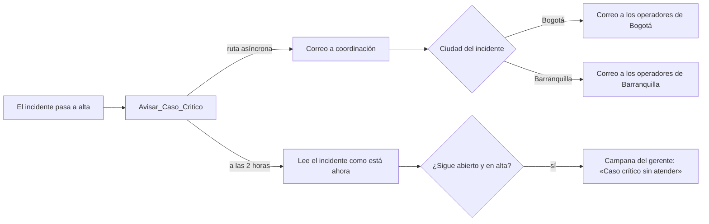

# 07 · Incidentes

Cubre **US-205 · Generar una sola intervención por mensaje crítico**.

En la interfaz, `Case` se llama **Incidente** y `Task` se llama **Intervención**, en
español y en inglés (decisión 67 de [estado](estado.md)). En el código y en este
documento se sigue diciendo «caso» cuando se habla del objeto.

## El concepto de base: idempotencia bajo concurrencia

«Un solo incidente por problema» parece una regla de negocio y es, en realidad, un
problema clásico de concurrencia.

La implementación ingenua es consultar si ya existe y crear si no existe:

```apex
// NO hacer esto
List<Case> abiertos = [SELECT Id FROM Case WHERE Clave_Abierta__c = :clave];
if (abiertos.isEmpty()) {
    insert nuevoCaso;
}
```

Entre la consulta y la inserción hay una ventana. Si dos transacciones entran a la vez,
las dos consultan, las dos ven vacío, las dos insertan, y aparecen dos casos para el mismo
problema. La ventana es de milisegundos, lo que significa que el defecto no aparece en
desarrollo y sí en producción, de forma intermitente, que es la peor combinación posible.

No es un escenario hipotético en este sistema. Los avisos llegan por un bus asíncrono que
la plataforma puede procesar en lotes paralelos, y el escenario `CRITICAL_BURST` existe
precisamente para producir ráfagas de mensajes críticos.

La única defensa sólida contra una condición de carrera es **una restricción de unicidad
en la base de datos**. No una comprobación en código, por cuidadosa que sea: una
restricción. La base de datos serializa los intentos y garantiza que solo uno gane, sin
ventana.

## La clave del incidente abierto

### El mecanismo

`Case.Clave_Abierta__c` es un campo de texto marcado como **External ID** y **Unique**.

Mientras un incidente está abierto, el campo contiene su clave. La base de datos hace
imposible que exista un segundo caso con la misma. Al cerrarlo, el campo **se vacía**.

La pieza que hace que esto funcione, y que no es obvia, es esta: **un índice único de
Salesforce admite tantos valores vacíos como haga falta.** Los nulos no colisionan entre
sí. Así que se consiguen dos cosas que normalmente se pelean:

- Nunca hay dos incidentes abiertos para el mismo problema, porque la clave está ocupada.
- Sí se puede abrir uno nuevo cuando el problema reaparece, porque al cerrar se liberó.

Todo eso sin una sola línea de lógica que lo compruebe.

### El formato de la clave

Depende del tipo de problema, porque la identidad de «el mismo problema» no es la misma en
los dos casos.

| Tipo | Clave | Ejemplo |
| --- | --- | --- |
| Medición | `codigoActivo\|tipoMedicion` | `AST-BOG-PUMP-001\|WATER_PRESSURE` |
| Conectividad | `CONN\|episodioId` | `CONN\|EPI-BOG-out-2` |

Para las mediciones, el mismo problema es «esta bomba tiene mal la presión». Da igual
cuántas lecturas críticas lleguen: es un problema.

Para la conectividad, el simulador nos regala una identidad mejor que cualquiera que
pudiéramos inventar. Cada corte trae su propio `episodeId` —`EPI-BOG-out-0`,
`EPI-BOG-out-2`, `EPI-BAQ-out-1`— y todos los mensajes de un mismo corte lo comparten. El
razonamiento está desarrollado en el [módulo 08](08-conectividad.md); la consecuencia aquí
es que dos cortes distintos de la misma cámara son dos problemas distintos y merecen dos
incidentes, mientras que los cinco mensajes de un mismo corte son uno solo.

El prefijo `CONN|` evita que un episodio y una medición colisionen en el mismo espacio de
claves.

## El flujo

Por cada aviso que clasifica como advertencia o crítico:

1. Se construye la clave según el tipo.
2. Se busca en el mapa de casos abiertos que se consultó al inicio de la tanda.
3. Si **no existe**, se prepara un caso nuevo.
4. Si **existe y la severidad nueva es mayor**, se prepara una actualización de prioridad.
5. Si **existe y la severidad nueva es igual o menor**, no se hace nada con el caso.

Los casos a crear y a actualizar se acumulan en listas y se escriben de una vez, según el
[módulo 04](04-procesamiento.md).

### La escalada

| Situación | Acción sobre el caso |
| --- | --- |
| Primera advertencia | Se crea con prioridad **baja**, sin propietario, visible en el tablero |
| Advertencia con caso ya abierto | Nada |
| Primer crítico, sin caso | Se crea con prioridad **alta** y entra en la cola del coordinador |
| Crítico con caso en prioridad baja | **Sube a alta** y entra en la cola. No se crea otro |
| Crítico con caso ya en alta | Nada con la prioridad |
| Vuelta a normal | El caso **no se cierra solo**: queda «Normalizado» |

La prioridad solo sube. Una lectura que baja de crítico a advertencia, o que vuelve a lo
normal, no la toca: la prioridad dice lo peor que pasó en el episodio, y lo que pasa ahora
lo dicen la condición del equipo y el monitor. Si bajara con cada lectura buena, un equipo
que oscila alrededor del límite haría subir y bajar el caso en la cola sin parar.

### Lo que el caso registra de las lecturas

El operador no puede leer la bitácora, así que «qué lectura abrió esto y qué pasó después»
tiene que estar en el propio caso. **Decisión: el caso guarda la lectura que lo abrió y la
última que cambió su severidad, en campos estructurados**: el texto con su unidad, la
severidad y la fecha de origen, más la clave de la señal para quien sí puede ir a la
bitácora.

La última lectura **solo se actualiza cuando la lectura cambia la severidad o la condición
registradas en el caso**: cuando lo abre, lo escala, lo baja, lo normaliza o vuelve a
fallar. Una lectura que repite la severidad no reescribe el caso. Con la ingesta trayendo
cientos de lecturas por minuto, actualizarlo con cada una lo reescribiría sin parar y
ocultaría el cambio que importa.

| Lectura sobre un caso abierto | Qué cambia en el caso |
| --- | --- |
| Misma severidad, mismo estado | Nada, y la señal no se liga al caso |
| Otra severidad de falla (sube o baja) | Última lectura, severidad, fecha y señal |
| Normal, o `RESTORED` en una cámara | Lo mismo, y **Condición del equipo** pasa a «Normalizado» con su fecha |
| Falla después de normalizado | Vuelve a «En falla» y se borra la fecha de normalización |

En una cámara, normalizado significa que **volvió la comunicación** (`RESTORED`), no que el
silencio todavía sea corto: un `LOST` de noventa segundos es normal por severidad, pero el
corte sigue abierto.

La normalización resuelve un problema concreto del monitor. Un equipo en normal con un caso
abierto mostraba «Ver incidente» sin explicación, y parecía un error. Ahora el caso dice
que el equipo se normalizó y cuándo, la cola de coordinación lo muestra en una columna para
que el coordinador verifique y cierre, y el monitor lo dice en la fila.

### Por qué se abre incidente ya en advertencia

Es una decisión que va más allá de lo que pide el enunciado y conviene justificarla,
porque US-206 dice que una advertencia se distingue visualmente «sin crear intervención
obligatoria».

La lectura es que no es obligatoria, no que esté prohibida. Y abrirla aporta algo concreto:
cuando la situación empeora a crítico, el caso **ya existe** y solo sube de prioridad. Eso
significa que el histórico del caso contiene el episodio completo, desde la primera
advertencia, en lugar de empezar en el momento en que ya era grave. Para un coordinador
que llega a diagnosticar, saber que la presión llevaba cuarenta minutos degradándose es
más útil que saber que ahora está mal.

El coste es más casos abiertos. Lo contiene la propia decisión de un caso por clave: una
bomba que oscila alrededor del límite produce **un** caso que escala, no cincuenta que
alguien tiene que cerrar a mano.

La prioridad baja y la ausencia de propietario son deliberadas: el caso existe y es
consultable, pero no entra en la cola de nadie ni exige acción hasta que escale.

### La cola del coordinador

La cola es una cola estándar de Case, **Coordinación**, sin correo a los miembros. El
coordinador es su miembro y la revisa con la vista de lista «Cola de coordinación», que
filtra los casos abiertos de la cola. Los miembros de usuario cambian en cada org, así que
no van en el metadato de la cola: los añade `scripts/crear-usuarios-demo.sh`.

`IncidentesServicio` deja a nombre de la cola el caso que nace en alta, y el que escala de
baja a alta mientras sigue siendo de quien corre el procesamiento. Si una persona ya lo
tomó, escala pero conserva su propietario: quitárselo para meterlo en una cola sería
deshacer una asignación que alguien hizo a propósito. «Sin propietario» significa, en la
práctica, que el caso es del usuario de integración que corre el procesamiento. No hay
un caso sin `OwnerId` en Salesforce.

La intervención que el operador abre a mano desde el monitor es suya desde el principio,
aunque el equipo esté en crítico, y no pasa por la cola.

### Por qué el caso no se cierra solo

Que un valor vuelva a la normalidad no significa que el problema se haya resuelto: puede
haberse resuelto, o puede que el sensor se haya averiado, o que la lectura buena sea una
casualidad entre dos malas.

**Decisión: el cierre es siempre una acción humana.** El sistema puede decir «ya no lo veo»
y lo dice: deja el estado actual en normal y el caso en «Normalizado», con la lectura que
lo normalizó y su fecha. En una cámara añade además a la descripción la línea «Recuperado».
Pero cerrar es afirmar que se arregló, y eso no lo sabe el sistema.

El precio es el riesgo R-18 y hay que decirlo claro: **al cerrar un caso hay que vaciar
`Clave_Abierta__c`.** Si ese paso fallara, ese activo y esa medición no podrían volver a
abrir un incidente **nunca más**, y el fallo sería invisible: no hay error, simplemente
nunca vuelve a pasar nada.

La defensa es doble. Un **flujo sobre el cierre del caso** vacía el campo, en lugar de
confiar en que la persona lo haga. Y una **prueba dedicada** cierra un caso, vuelve a
poner el activo en crítico y verifica que se abre uno nuevo. Esa prueba está en el
[plan de pruebas](12-plan-de-pruebas.md) y no es negociable.

## Las garantías ante entregas concurrentes

US-205 pide explícitamente que el equipo explique el mecanismo y sus límites. Esta sección
es esa explicación.

### Lo que sí garantiza

**Contra duplicados del proveedor.** El escenario `DUPLICATES` reenvía el mismo
`messageId`. La barrera está antes de llegar aquí: la ingesta reconoce el reenvío por
`Senal__c.Clave__c` y **no publica el evento**. El procesamiento ni se entera.

**Contra reentregas del bus.** Un bus «al menos una vez» puede entregar el mismo aviso dos
veces. Aquí la barrera es la clave del incidente: el segundo procesamiento encuentra el
caso abierto y no crea otro. La operación es idempotente.

**Contra transacciones concurrentes.** Dos lotes procesados en paralelo que contengan
mensajes críticos del mismo activo. Ninguno ve al otro en su consulta inicial, los dos
preparan un caso nuevo, y los dos lo insertan. Aquí la barrera es la base de datos: uno
gana y el otro recibe un error de valor duplicado. La ventana de la condición de carrera
no existe, porque la comprobación y la escritura son la misma operación.

Que el perdedor reciba un error es esperado y **no es un fallo**. El código lo trata
explícitamente:

```apex
Database.SaveResult[] resultados = Database.insert(casos, false);
for (Integer i = 0; i < resultados.size(); i++) {
    if (resultados[i].isSuccess()) { continue; }
    if (esDuplicado(resultados[i])) {
        // Otra transacción ganó la carrera. El caso existe, que es lo que queríamos.
        // Se reintenta la escalada de prioridad sobre el caso ganador.
        parEscalar.add(casos[i].Clave_Abierta__c);
    } else {
        marcarSenalFallida(i, resultados[i]);
    }
}
```

El detalle de reintentar la escalada importa: sin él, el crítico del perdedor se perdería
y el caso ganador podría quedar en prioridad baja aunque hubiera llegado un crítico.

### Los límites, dichos en voz alta

**No es una transacción distribuida.** Si la creación del caso falla, el estado actual ya
quedó escrito y no se revierte. La justificación está en el
[módulo 04](04-procesamiento.md) y la señal queda con resultado fallido y motivo. Estado e
incidente pueden quedar momentáneamente desalineados, y eso es deliberado.

**Depende de que el cierre libere la clave.** Es el riesgo R-18.

**No protege contra dos claves distintas para el mismo problema real.** Si la misma bomba
tuviera dos sensores de presión reportando como activos distintos, serían dos incidentes.
Con el catálogo actual no pasa: cada activo tiene un sensor y una medición.

**Un conflicto no lo resuelve.** Una misma clave de mensaje con contenido distinto se
marca como conflicto en la bitácora y **no** genera ni escala incidentes. Requiere decisión
humana, porque el sistema no tiene forma de saber cuál de las dos afirmaciones es cierta.

## El caso de no encontrar el activo

Si el aviso llega con un activo que no existe, no hay incidente que abrir ni a qué
colgarlo. La señal se rechaza con motivo «activo no encontrado», reintentable.

Esto ocurre antes de llegar aquí, en la validación de la ingesta, pero conviene tenerlo
presente: **un incidente siempre cuelga de un activo existente.** No hay incidentes
huérfanos.

## Cómo se ve la trazabilidad

Cada caso guarda en `Origen_Senal__c` la clave de la señal que lo abrió y en
`Ultima_Senal__c` la del último cambio, y cada señal guarda en `Incidente__c` el caso que
abrió, escaló, bajó o normalizó. La relación es navegable en los dos sentidos.

**Decisión: una lectura que repite la severidad no se liga al caso.** Antes se ligaba, y
con el simulador mandando cientos de lecturas por minuto un caso llegó a tener 42.602
señales: mucha carga sobre un solo registro (sesgo de datos), que frena cada escritura y
cada consulta que lo toca. Las lecturas que no cambiaron nada se ven en «Lecturas del
periodo», que las busca por el activo y las fechas del caso, no por la relación. Las
202.115 señales que ya estaban ligadas se conservan: la limpieza guarda las ligadas a
cualquier caso, y a esos casos ya no les llegan señales nuevas por repetición.

Eso permite dos preguntas que el administrador va a hacer: «¿qué mensaje abrió este caso?»
y «¿este mensaje produjo algún caso?». Sin los dos campos, la segunda exigiría recorrer
todos los casos comparando claves.

## El aviso cuando un incidente entra en rojo

Hasta aquí, un incidente crítico esperaba a que alguien abriera el monitor o la cola.
**Decisión: un flujo, `Avisar_Caso_Critico`, avisa en el momento en que el incidente pasa a
prioridad alta**, por correo a quienes tienen que actuar y, si sigue en rojo, en la campana
del gerente.



**Cuándo se dispara.** Es un flujo desencadenado por registro sobre `Case`, después de
guardar, al crear o al actualizar, con la condición «prioridad alta» y «solo cuando el
registro se actualiza para cumplir la condición». Así cubre los incidentes que nacen en
rojo, que son la mayoría, y los que escalan desde advertencia, y sale **un solo aviso por
incidente**: las lecturas siguientes que mantienen el rojo no lo repiten. Una advertencia
nunca avisa. En la org llegan unos tres incidentes en alta por semana.

| Alternativa | Por qué no |
| --- | --- |
| Apex en `IncidentesServicio` con `Messaging.sendEmail` | Cuenta contra el límite de 15 correos individuales por día de esta org; las alertas cuentan contra el de 61.125. Además ata el correo al procesamiento, que no debe fallar por un correo |
| Solo al actualizar | Dejaría sin aviso a los que nacen en rojo |
| Avisar en cada lectura crítica | Decenas de correos por el mismo incidente; el aviso es por incidente, como el caso |

**La ruta asíncrona.** Las alertas no van en la transacción que guarda el incidente, sino en
la ruta asíncrona del flujo, que corre después de confirmarla. El procesamiento crea los
incidentes con guardado parcial: si la alerta fuera en la misma transacción y fallara, el
incidente no se guardaría y su señal quedaría Fallido. Así, si un correo falla, el
incidente ya existe.

**A quién.** Tres alertas de correo, `Critico_Coordinacion`, `Critico_Operadores_Bogota` y
`Critico_Operadores_Barranquilla`, cada una a un grupo nuevo solo para avisos: Avisos
Coordinación, Avisos Bogotá y Avisos Barranquilla. El flujo elige la de operadores por
`Ciudad__c`; un incidente sin ciudad solo avisa a coordinación. Los grupos de la
compartición (Operadores Bogotá y los demás) no sirven para esto, porque incluyen al
coordinador y al gerente, que recibirían el correo del operador. Los llena
`scripts/apex/crear-usuarios-demo.apex`, y la compartición no cambia.

**A las 2 horas.** La ruta programada lee el incidente de nuevo y avisa al grupo Avisos
Gerencia con la notificación personalizada «Caso crítico sin atender» solo si sigue
abierto y en alta. Lo comprueba ahí porque cerrar un incidente no le baja la prioridad.
Al tocar la notificación se abre el incidente.

**Las plantillas.** Dos plantillas HTML clásicas, en la carpeta «Nova Casa · Avisos»:

- `Critico_Operador`: qué pasa y dónde. El equipo, el edificio y la ciudad, la lectura que
  lo puso en rojo (en una cámara, el corte), la hora y quién lo tiene, con el botón «Ver el
  incidente».
- `Critico_Coordinador`: los datos para decidir. Cómo llegó a rojo, la lectura que lo abrió
  y la que lo puso en rojo con su severidad, la hora y quién lo tiene, con el botón «Abrir
  el incidente».

Llevan el logo sobre blanco con la franja azul de la marca debajo, la palabra «CRÍTICO» en
una pastilla roja y no solo el color, texto alternativo en el logo, una versión de texto
plano y `lang="es"`. El logo es un Documento con imagen disponible externamente
(`documents/Nova_Casa_Correo`), recortado a su contenido para que se alinee con el texto:
un cliente de correo no puede leer los recursos internos de Salesforce, y un recurso de
contenido de la marca exige sesión. Son plantillas clásicas porque las alertas de correo
las usan con campos de combinación del caso, sin código.

**La hora.** El correo muestra la hora en que Salesforce guardó el cambio, en hora de
Bogotá, desde la fórmula `Hora_Cambio_Texto__c` sobre la última modificación. La hora del
sensor viene del reloj del simulador («12/06/2030») y en un correo confunde; se ve dentro
del incidente. La fórmula toma la fecha del texto en GMT y le resta cinco horas: `DATEVALUE`
la pasaría a la zona de quien envía y cambiaría el día cerca de la medianoche.

**El remitente** es la dirección de la organización «Nova Casa · Monitoreo», no el usuario
de integración ni quien guardó el caso. Salesforce exige que esté verificada antes de
desplegar una alerta que la use.

## La intervención

El incidente es un `Case`. La **intervención** es una `Task`, que se ve en la historia del
incidente, y la crea el coordinador manualmente al decidir qué hay que hacer.

**No se crean tareas automáticamente.** El sistema detecta y prioriza; asignar trabajo es
una decisión humana que depende de quién está disponible, qué más hay en curso y qué
importa más hoy. Un sistema que asigna tareas solo termina generando trabajo que nadie
hizo y que hay que limpiar.

El operador sí tiene un botón «abrir intervención» en su pantalla, descrito en el
[módulo 09](09-experiencia-del-operador.md), para los equipos que están bien o sin datos y
que por tanto no generaron caso automático. Es el camino de «vi algo raro que el sistema no
detectó», y es el que cierra el recorrido de ver a hacer en una sola pantalla.
